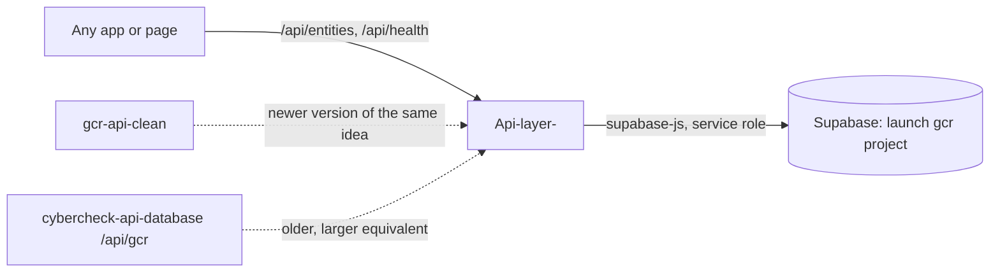

# Api-layer-

A small Express + Supabase API for listing local businesses ("entities"), showing one business page, and accepting booking requests, song requests and tool installs.

## What it is

A compact prototype back end (about 15 files, no tests, no front end). An app asks it for a list of businesses, or for everything about one business by its slug, and can post bookings and song requests for that business. It is wired to the "launch gcr" Supabase project, which the newer `gcr-api-clean` project's notes say is not the live database.

## How it works

- `server.js` loads `.env`, enables CORS (origins from `CORS_ORIGIN`, any origin if unset), mounts `/api/health` and `/api/entities`, then the handlers in `middleware/errorHandler.js`. Port is `PORT`, default 3001.
- `config/db.js` builds the Supabase client from `GCR_SUPABASE_URL` and `GCR_SUPABASE_SERVICE_KEY` and exits if either is missing.
- `routes/entities.js`:
  - `GET /api/entities` is a paged list of table `entity`, filterable by type, subtype, city and search text.
  - `GET /api/entities/:slug` returns the entity plus hours, photos, tags, features, perfect-for, events, specials, sections and tools; section content is filled in by `utils/sections.js`.
- `routes/bookings.js`: `POST` and `GET /api/entities/:slug/bookings` (table `bookings`).
- `routes/song-requests.js`: `POST` and `GET` for artists and song requests (tables `artists`, `song_requests`).
- `routes/tools.js`: `GET` and `PUT /:toolKey` on `entity_tools`.
- `routes/health.js`: pings table `entity`.
- The business is looked up from the slug in the URL (`utils/lookupEntity.js`).

## Run it

```bash
npm install
cp .env.example .env   # then fill in the values
npm start              # node server.js  (npm run dev uses node --watch)
```

Environment variable names: `GCR_SUPABASE_URL`, `GCR_SUPABASE_SERVICE_KEY` (both required), `PORT`, `NODE_ENV`, `CORS_ORIGIN`. Not started or tested while writing this README, and whether every table it reads exists in the target project was not verified.

## Status

Stalled: a tidy prototype pointed at the "launch gcr" database, superseded by `gcr-api-clean` and `cybercheck-api-database`.

## Where it fits



No caller of this repo was found in the other repos audited.

## Related repos

- gcr-api-clean: the cleaned-up successor; this code's own comment refers to "same pattern as gcr-api-clean".
- cybercheck-api-database: its `/api/gcr` routes use the same table names (entity, entity_hours, entity_sections, section_*) against a different database.
